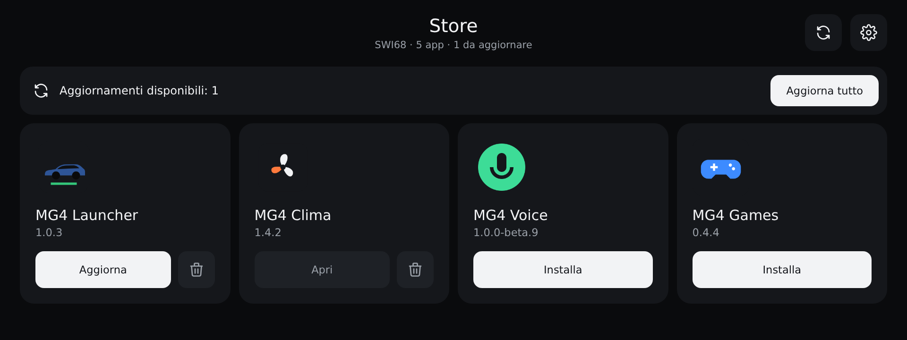
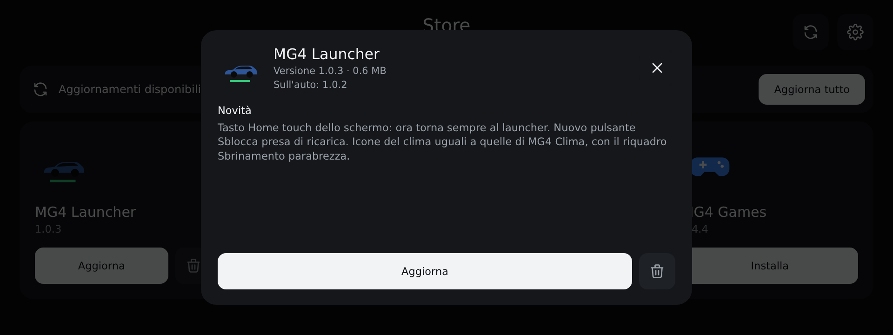
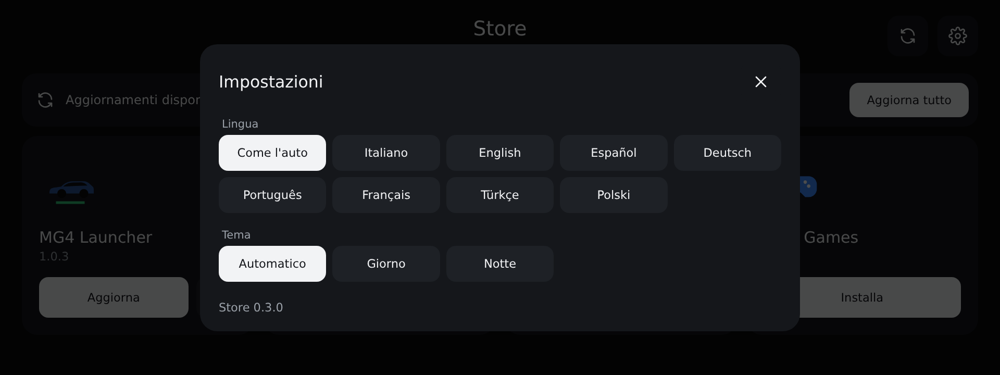

# MG4 Store

<p align="center"></p>

<p align="center">
<b>Lo store delle app MG4, direttamente sull'infotainment dell'auto</b><br>
<i>The MG4 app store, right on the car's infotainment</i>
</p>

<p align="center">
<a href="releases/MG4Store-0.3.0.apk"></a>
<a href="https://paypal.me/ErnestoMicco?locale.x=it_IT&country.x=IT"></a>
</p>

<p align="center">
🇮🇹 <a href="#italiano">Italiano</a> · 🇬🇧 <a href="#english">English</a> ·
<a href="#app-nello-store--apps-in-the-store">App nello store / Apps in the store</a> ·
<a href="#versioni">Novità</a> / <a href="#changelog">What's new</a>
</p>

> ⚠️ **Compatibilità / Compatibility:** infotainment MG4 con software **SWI68 SAIC 1.0+**, **SWI69 Color Radio**, **SWI132** e **SWI133** ·
> MG4 infotainment with **SWI68 SAIC 1.0+**, **SWI69 Color Radio**, **SWI132** and **SWI133** software.
> Lo store riconosce da solo il software dell'auto e mostra solo le app adatte · the store detects the car's software by itself and shows only the apps that fit.
> Su telefoni, tablet ed emulatori non funziona · it does not work on phones, tablets or emulators.

---

## Schermate / Screenshots

<table>
<tr>
<td width="50%" valign="top"><br>
<sub><b>Dettaglio</b>: versione, dimensione, versione installata e novità · <i><b>Details</b>: version, size, installed version and what's new</i></sub></td>
<td width="50%" valign="top"><br>
<sub><b>Impostazioni</b>: 8 lingue e tema giorno, notte o automatico · <i><b>Settings</b>: 8 languages and day, night or automatic theme</i></sub></td>
</tr>
</table>

<sub>Simulazioni della grafica: versioni e app sono di esempio · Design mock-ups: versions and apps are examples.</sub>

---

## App nello store / Apps in the store

| App | Cosa fa / What it does | Software | Repository |
|---|---|---|---|
| **MG4 Launcher** | Home in stile Tesla · Tesla-style home screen | SWI68, SWI69, SWI132, SWI133 (la versione giusta in automatico · the right version automatically) | [SWI68](https://github.com/ernestomicco2026-cell/Mg4-Launcher-SWI68) · [SWI69](https://github.com/ernestomicco2026-cell/Mg4-Launcher-SWI69) · [SWI132](https://github.com/ernestomicco2026-cell/Mg4-Launcher-SWI132) · [SWI133](https://github.com/ernestomicco2026-cell/Mg4-Launcher-SWI133) |
| **MG4 Clima** | Schermata del clima in stile Tesla · Tesla-style climate screen | SWI68, SWI69, SWI132, SWI133 | [HVAC-Clima-MG4](https://github.com/ernestomicco2026-cell/HVAC-Clima-MG4) |
| **MG4 Voice** | Assistente vocale offline in italiano (beta) · offline Italian voice assistant (beta) | SWI68 | [Mg4-Voice](https://github.com/ernestomicco2026-cell/Mg4-Voice) |
| **MG4 Task Manager** | Elenco delle app aperte e chiusura con un tocco · open apps list and one-tap close | SWI68, SWI69, SWI132, SWI133 | [mg4-taskmanager](https://github.com/ernestomicco2026-cell/mg4-taskmanager) |

Lo store prende sempre l'ultima versione pubblicata nel repository di ogni app, di solito entro un'ora dall'uscita.
The store always offers the latest version published in each app's repository, usually within an hour of release.

---

## Italiano

MG4 Store è l'app che installa e aggiorna le app MG4 direttamente sull'infotainment, senza chiavetta USB e senza
computer. Si installa una volta sola, come una normale app; da lì in poi le altre app arrivano con un tocco.

**Indice:** [Cosa fa](#cosa-fa) · [Come funziona l'accesso](#come-funziona-laccesso) · [Installazione](#installazione) · [Aggiornamenti](#aggiornamenti) · [Aggiungere un'app](#aggiungere-unapp-allo-store) · [Dati inviati](#dati-inviati) · [Segnalare un problema](#segnalare-un-problema) · [Sostieni il progetto](#sostieni-il-progetto) · [Versioni](#versioni)

### Cosa fa

- **Griglia delle app** con l'icona vera di ogni app, il nome e la versione. Compaiono solo le app adatte al
  software della tua auto: il launcher, per esempio, c'è una volta sola, nella versione giusta.
- **Installa, Aggiorna, Apri**: lo store sa quali app hai già e a che versione. Durante il download il pulsante
  mostra la percentuale; l'installazione non chiede conferme e le app già installate si aggiornano senza
  disinstallarle.
- **Disinstalla**: accanto al pulsante principale, il cestino toglie l'app dall'auto. Prima chiede una conferma,
  così un tocco sbagliato durante la guida non cancella niente.
- **Home MG di riserva**: se il launcher viene tolto dal menu App di Android, lo store riaccende la home MG originale,
  così l'auto non resta ferma sulla schermata *Smartphone starting*.
- **Dettaglio dell'app**: tocca un riquadro per vedere versione, dimensione, versione installata sull'auto e novità.
- **Aggiorna tutto**: quando ci sono versioni nuove, sopra la griglia compare la barra *Aggiornamenti disponibili*
  con il tasto che le installa una dopo l'altra.
- **Notifica degli aggiornamenti**: ogni 6 ore, anche con lo store chiuso, l'auto controlla se ci sono versioni nuove
  delle app installate e lo dice con una notifica (una volta sola per gli stessi aggiornamenti).
- **8 lingue** (italiano, inglese, spagnolo, tedesco, portoghese, francese, turco, polacco), automatica come l'auto
  o scelta nelle impostazioni; **tema** giorno, notte o automatico, con i colori del launcher.

### Come funziona l'accesso

Non serve nessun account e nessun codice. Alla prima apertura lo store controlla di girare davvero sull'infotainment
di una MG4, poi registra l'auto in forma anonima: da quel momento la riconosce sempre. Su telefoni, tablet ed
emulatori lo store mostra *Questo dispositivo non è un'infotainment MG4* e non scarica niente.

### Installazione

Scarica l'APK dalla cartella [`releases/`](releases/). Si installa come una normale app, in due modi.

#### Metodo 1: da chiavetta USB (senza computer)

1. Copia `MG4Store-0.3.0.apk` su una chiavetta USB formattata **FAT32** o **exFAT**.
2. Inserisci la chiavetta nell'auto, apri il file manager e tocca l'APK.
3. Se Android avvisa che non può installare app da questa fonte: tocca **Impostazioni**, attiva
   **Consenti da questa fonte** per il file manager e torna indietro.
4. Tocca **Installa**, poi apri **Store** dall'elenco delle app.

Se l'installazione dà errore, usa il metodo 2.

#### Metodo 2: con adb da computer

Serve un computer con [adb](https://developer.android.com/tools/releases/platform-tools) collegato all'auto.

```bash
adb install -r -f MG4Store-0.3.0.apk
```

### Aggiornamenti

Lo store si aggiorna da solo, come le altre app: quando esce una sua versione nuova compare per primo nella griglia
con il tasto **Aggiorna**. Con *Aggiorna tutto* viene installato per ultimo, perché alla fine si riavvia.

### Aggiungere un'app allo store

Lo store è aperto anche alle app di altri sviluppatori della community MG4.

- **Se sviluppi un'app per la MG4** e vuoi che arrivi agli utenti dallo store, apri una richiesta nella sezione
  [Issues](../../issues) con il link al repository. Basta che l'app funzioni sull'infotainment e che le versioni
  siano pubblicate su GitHub: da lì lo store prende da solo ogni nuova versione, senza che tu debba fare altro.
- **Se usi un'app che vorresti trovare nello store**, chiedilo al suo autore: se è d'accordo, me lo fa sapere e la
  aggiungo. Un'app entra nello store solo con il consenso di chi l'ha scritta.

### Dati inviati

Per riconoscere l'auto lo store invia al proprio server un identificativo anonimo (un'impronta calcolata
sull'infotainment, che non permette di risalire all'auto o al proprietario), produttore e modello
dell'infotainment, versione di Android e software dell'auto (SWI68, SWI69, SWI132 o SWI133). Nient'altro: niente
posizione, niente dati del veicolo, niente dati personali.

### Segnalare un problema

Se lo store non carica, sotto il messaggio di errore compare in piccolo il motivo tecnico (per esempio
`HTTP 502`): uno screenshot di quella schermata basta per capire cosa succede. Le segnalazioni si aprono nella
sezione [Issues](../../issues) di questo repository.

### Sostieni il progetto

MG4 Store è e resterà **gratuito**, come tutte le app che distribuisce. Se ti è utile e vuoi contribuire alle ore
passate a svilupparlo e provarlo in auto, puoi lasciare un'offerta: è del tutto **volontaria** e **non c'è un
importo minimo**, puoi donare quello che vuoi. Anche una stella al repository o una segnalazione di un problema sono
un aiuto prezioso. Grazie!

Anche solo **2 €** sono un aiuto prezioso per continuare a sviluppare e provare in auto le nuove versioni.

[](https://paypal.me/ErnestoMicco?locale.x=it_IT&country.x=IT)

### Versioni

#### 0.3.0
- **Riquadri delle app più grandi**, più facili da leggere e da toccare.
- Pulsante **Disinstalla** (il cestino), con conferma.
- Se il launcher viene tolto dal menu App di Android, lo store **riaccende la home MG originale**: l'auto non resta
  su *Smartphone starting*.

#### 0.2.1
- Lo store si apre **a schermo intero**, senza le barre di sistema, come il launcher.
- Titolo **Store** al centro, con il software dell'auto e il numero di app sotto.

#### 0.2.0
- **Icone vere** delle app, prese dai loro repository.
- Barra **Aggiornamenti disponibili** con il tasto **Aggiorna tutto**.
- **Notifica** degli aggiornamenti ogni 6 ore, anche con lo store chiuso.
- Lo store **si aggiorna da solo**: la sua versione nuova compare nella griglia quando esce.
- Una sola voce per **MG4 Task Manager**.

#### 0.1.1
- Sotto i messaggi di errore compare il motivo tecnico, utile per le segnalazioni.

#### 0.1.0 (prima versione)
- Griglia delle app adatte al software dell'auto, con Installa, Aggiorna e Apri.
- Riconoscimento automatico dell'auto, senza codici.
- Installazione con un tocco, senza chiavetta USB.
- 8 lingue, tema giorno e notte.

#### Compilare

Il progetto si compila senza Gradle, con lo script `build.sh` (aapt2, javac, D8 e firma):

```bash
./build.sh
```

Servono Java (JDK 17 o successivo), Python 3, e `android.jar` (API 28) e `d8.jar` nella cartella `tools/`.
La chiave che lo store usa per parlare con il server non è nel repository: una copia compilata da altri funziona,
ma il catalogo non risponde.

---

## English

MG4 Store is the app that installs and updates MG4 apps directly on the infotainment, with no USB stick and no
computer. You install it once, like a normal app; from then on the other apps arrive with one tap.

**Contents:** [Features](#features) · [How access works](#how-access-works) · [Installation](#installation) · [Updates](#updates) · [Adding an app](#adding-an-app-to-the-store) · [Data sent](#data-sent) · [Reporting a problem](#reporting-a-problem) · [Support the project](#support-the-project) · [Changelog](#changelog)

### Features

- **App grid** with each app's real icon, name and version. Only the apps that fit your car's software are shown:
  the launcher, for example, appears once, in the right version.
- **Install, Update, Open**: the store knows which apps you already have and which version. While downloading, the
  button shows the percentage; installing asks for no confirmation, and installed apps update without being
  removed first.
- **Uninstall**: next to the main button, the bin removes the app from the car. It asks for confirmation first, so a
  wrong tap while driving deletes nothing.
- **Spare MG home**: if the launcher is removed from the Android Apps menu, the store turns the original MG home back
  on, so the car doesn't get stuck on the *Smartphone starting* screen.
- **App details**: tap a tile to see version, size, the version installed in the car and what's new.
- **Update all**: when new versions are out, an *Updates available* bar appears above the grid with a button that
  installs them one after the other.
- **Update notification**: every 6 hours, even with the store closed, the car checks for new versions of the
  installed apps and shows a notification (only once for the same updates).
- **8 languages** (Italian, English, Spanish, German, Portuguese, French, Turkish, Polish), following the car or
  chosen in the settings; **theme** day, night or automatic, with the launcher's colours.

### How access works

No account and no code are needed. On first launch the store checks that it is really running on an MG4
infotainment, then registers the car anonymously and recognises it from then on. On phones, tablets and emulators
the store shows *This device isn't an MG4 infotainment* and downloads nothing.

### Installation

Download the APK from the [`releases/`](releases/) folder. It installs like a normal app, in two ways.

#### Method 1: from a USB stick (no computer)

1. Copy `MG4Store-0.3.0.apk` to a USB stick formatted **FAT32** or **exFAT**.
2. Plug the stick into the car, open the file manager and tap the APK.
3. If Android says it can't install apps from this source: tap **Settings**, enable **Allow from this source**
   for the file manager and go back.
4. Tap **Install**, then open **Store** from the app list.

If the installation fails, use method 2.

#### Method 2: with adb from a computer

You need a computer with [adb](https://developer.android.com/tools/releases/platform-tools) connected to the car.

```bash
adb install -r -f MG4Store-0.3.0.apk
```

### Updates

The store updates itself like the other apps: when a new version is out it appears first in the grid with the
**Update** button. With *Update all* it is installed last, because it restarts at the end.

### Adding an app to the store

The store is open to apps from other developers in the MG4 community too.

- **If you develop an app for the MG4** and want it to reach users through the store, open a request in the
  [Issues](../../issues) section with a link to the repository. The app just needs to run on the infotainment and
  have its versions published on GitHub: from there the store picks up every new version by itself, with nothing
  else for you to do.
- **If you use an app you'd like to find in the store**, ask its author: if they agree, they let me know and I add
  it. An app only goes into the store with the consent of whoever wrote it.

### Data sent

To recognise the car, the store sends its server an anonymous identifier (a fingerprint computed on the
infotainment, which can't be traced back to the car or its owner), the infotainment's manufacturer and model, the
Android version and the car's software (SWI68, SWI69, SWI132 or SWI133). Nothing else: no location, no vehicle data,
no personal data.

### Reporting a problem

If the store doesn't load, the technical reason appears in small print under the error message (for example
`HTTP 502`): a screenshot of that screen is enough to understand what's going on. Reports go in this repository's
[Issues](../../issues).

### Support the project

MG4 Store is and will stay **free**, like all the apps it distributes. If you find it useful and want to contribute
to the hours spent developing and testing it in the car, you can leave a donation: it is completely **voluntary**
and **there is no minimum amount**, give whatever you like. A star on the repository or a problem report are a
precious help too. Thank you!

Even just **€2** is a precious help to keep developing and testing new versions in the car.

[](https://paypal.me/ErnestoMicco?locale.x=it_IT&country.x=IT)

### Changelog

#### 0.3.0
- **Bigger app tiles**, easier to read and to tap.
- **Uninstall** button (the bin), with confirmation.
- If the launcher is removed from the Android Apps menu, the store **turns the original MG home back on**: the car
  doesn't get stuck on *Smartphone starting*.

#### 0.2.1
- The store opens **full screen**, without the system bars, like the launcher.
- **Store** title in the centre, with the car's software and the number of apps below.

#### 0.2.0
- **Real icons** of the apps, taken from their repositories.
- **Updates available** bar with the **Update all** button.
- Update **notification** every 6 hours, even with the store closed.
- The store **updates itself**: its new version appears in the grid when it's out.
- A single entry for **MG4 Task Manager**.

#### 0.1.1
- The technical reason now appears under error messages, useful for reports.

#### 0.1.0 (first version)
- Grid of the apps that fit the car's software, with Install, Update and Open.
- Automatic car recognition, no codes.
- One-tap installation, no USB stick.
- 8 languages, day and night theme.

#### Building

The project builds without Gradle, with the `build.sh` script (aapt2, javac, D8 and signing):

```bash
./build.sh
```

You need Java (JDK 17 or later), Python 3, and `android.jar` (API 28) and `d8.jar` in the `tools/` folder.
The key the store uses to talk to its server isn't in the repository: a copy built by someone else runs, but the
catalog doesn't answer.
